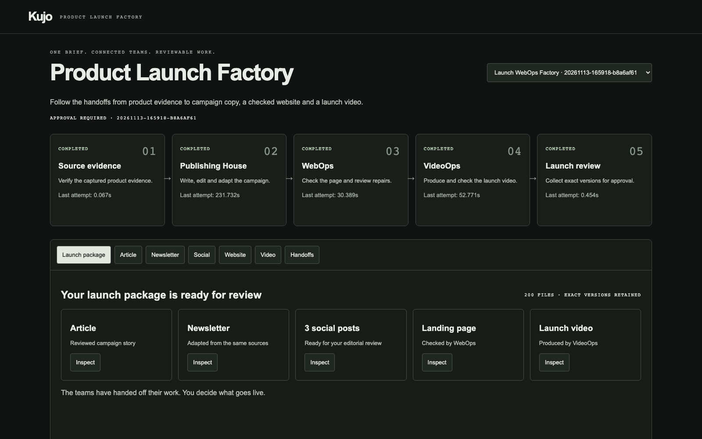

# Kujo Product Launch Factory

[](package.json)
[](LICENSE)
[](https://github.com/kujolang/product-launch-factory/actions)
[](https://github.com/kujolang/kujo)

Give your team one launch brief. Get a website, article, newsletter, social posts and video tied to the same evidence and ready for review.

https://github.com/user-attachments/assets/8edadc12-8bf9-4531-956a-53f0d036215f

Watch Product Launch Factory coordinate the teams, hand off checked work and collect the launch package. [Download the demo](https://raw.githubusercontent.com/kujolang/product-launch-factory/main/docs/media/product-launch-demo/launch.mp4).

Product Launch Factory coordinates the existing Kujo factories through versioned handoffs. Its visual floor shows the work, what passed, what is blocked and which files need your approval.

## What it does

| Station | Work | Output |
| --- | --- | --- |
| Source evidence | Verify a Software Factory export or an existing WebOps package. | Captured product evidence and source texts. |
| Publishing House | Commission, draft, independently edit and adapt the campaign. | Article, newsletter, three social posts and landing copy. |
| WebOps | Check the static landing page and review bounded repairs. | Website candidate, browser screenshots and check evidence. |
| VideoOps | Plan, compile, render and check a video from registered product images. | MP4, editable composition and production records. |
| Launch review | Collect exact versions and detect drift. | A local package awaiting human approval. |

The controller reuses pinned factories. A new product changes the brief and source packet, not the controller. This release verifies existing software evidence; it does not build a new application or publish a campaign automatically.

## Get started

Use macOS or Linux with Git, Python 3.10+, Node 26.12.1, npm and FFmpeg. Chromium also needs its operating-system libraries. A Codex login with model access is required for live work.

```sh
git clone https://github.com/kujolang/product-launch-factory.git
cd product-launch-factory
npm ci
npm run setup
npm run login
npm run doctor
npm run factory -- run examples/webops-launch.json
```

In another terminal, run `npm start` and open `http://127.0.0.1:4384`. The example launches WebOps Factory from captured repository evidence. It makes real model calls and produces a silent video by default. [Narration](docs/VIDEO.md) requires a separately configured, explicitly authorized speech request or existing recording.

Give your agent the [setup guide](docs/AGENT-SETUP.md), your product idea and its source evidence. The guide covers installation, brief changes, recovery and review.

## Inspect the recorded example

```sh
npm run demo
npm start
```

This imports the included campaign for read-only viewing and makes no model calls. Its floor is labeled **Recorded example**. The package includes the article, newsletter, three social posts, website, video and exact source evidence. WebOps Factory is this example campaign's subject. Its [generated campaign clip](docs/example-run/package/video/launch.mp4) is separate from the coordinator demonstration at the top of this README.



## Resume and review

```sh
npm run factory -- status
npm run factory -- resume RUN_ID
npm run factory -- verify RUN_ID
```

Completed handoffs are reused only when their exact bytes still match. Blocked work stays blocked until its cause is resolved. Changed inputs require a new launch version. The floor previews copy, the website and video while showing the real stage state.

Review every deliverable before recording approval. Play the entire video with sound. Approval names the exact package hash and remains local; this repository has no deployment command. Editing, adding or deleting a packaged file invalidates its reviewed version.

## Qualification and limits

The retained WebOps launch campaign completed all five stages. Its 200-file package verifies, and a repeat invocation reuses all handoffs without changing provider artifacts. The video has ElevenLabs Siren narration and a Kujo bumper. Technical verification is complete; human editorial approval and full listening review remain required. See [verification](docs/VERIFICATION.md) for evidence and limits.

Dependency setup took 111.688 seconds on a busy development machine with existing tools and caches. That excludes prerequisites, cloning, root npm installation and login. It is **not a clean-machine onboarding benchmark** or a universal setup promise.

Source text goes to the configured model account. Hashes detect changed bytes; they do not prove factual accuracy, test quality or authorship. The local floor binds to loopback. Its preview policy blocks scripts in generated pages. This is a single-operator tool, not a hosted multi-tenant service.

## Development

```sh
npm ci
npm run verify
```

Contract tests need no provider credentials. Live factory qualification is separate. Keep private inputs, credentials and runtime work out of Git.

- [Agent setup](docs/AGENT-SETUP.md)
- [Architecture and handoffs](docs/ARCHITECTURE.md)
- [Video and narration](docs/VIDEO.md)
- [Verification](docs/VERIFICATION.md)
- [Security boundaries](SECURITY.md)
- [Pinned factory revisions](sources.lock.json)
